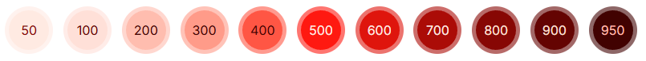
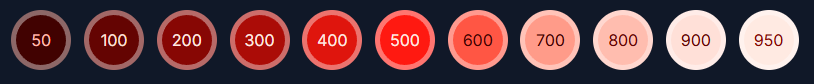
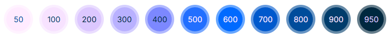
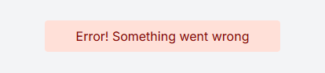
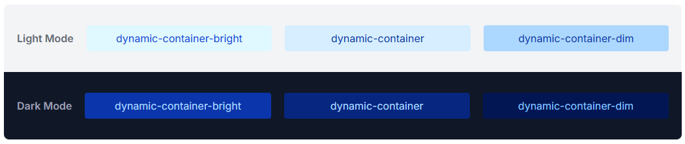

# @zyphox/tailwind-dynamic-colors

A tailwind v4 utility to generate dynamic color palettes using oklch! No javascript needed, all written in css.

This utility will generate 11 tones based off an input color, similar to the built in tailwind colors.

[Documentation + Live Demo ↗](https://zyphox.dev/docs/tailwind-dynamic-colors)

[](https://www.npmjs.com/package/@zyphox/tailwind-dynamic-colors)

```html
<div class="color-dynamic bg-dynamic-300"></div>
```



## Installation

Install the component:

```sh
npm i @zyphox/tailwind-dynamic-colors
```

Once installed, import the utility into you stylesheet

```css
@import 'tailwindcss';

/* Include the Dynamic Colors Plugin */
@import '@zyphox/tailwind-dynamic-colors';
```

Add the color-dynamic class to any element that you want to add color to:

```js
<div class="color-dynamic"></div>
```

Define the `--color-dynamic` css variable to give it a base color:

```js
<div class="color-dynamic" style="--color-dynamic: blue"></div>
```

Use it with any of the built in tailwind utility classes such as bg-\*, text-\* or border-\*:

```css
bg-dynamic-200;
text-dynamic-700;
border-dynamic-950;
```

```js
<div class="color-dynamic bg-dynamic-200" style="--color-dynamic: blue"></div>
```

**Note:** This utility automatically adds the contrasting text color when using the bg-dynamic-\* class.

## Dark Mode

For dark themes, the palette can be inverted with the following css:

```css
--color-dynamic-direction: -1;
```



## Hue Shifting

If you want the color to change hue over its tones, you can apply a hue shift. The middle tone (500) uses the input color's hue and then either adds or subtracts the hue-shift value for each subsequent tone:

```css
--color-dynamic-hue-shift: 10;
```



## Containers

You can use the shorthand `dynamic-container`, `dynamic-container-bright` or `dynamic-container-dim` to automatically apply the bg and text color. With these predefined classes, you can keep consistency across your app with which shades are used.

```js
<div class="dynamic-container" style="--dynamic-color: red">
  Error! Something went wrong.
</div>
```





## Advanced

View the [Documentation](https://zyphox.dev/docs/tailwind-dynamic-colors) to learn more about the advanced configuration options available.
